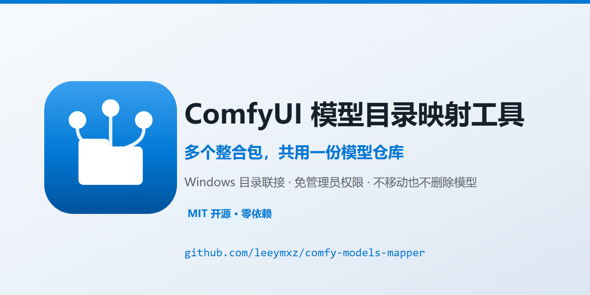
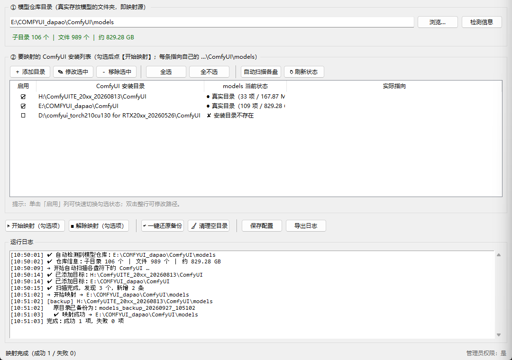

<div align="center">
  
</div>

# ComfyUI 模型目录映射工具

把多个 ComfyUI 整合包的 `models` 目录，统一映射到**一份真实的模型仓库**，
避免几百 GB 的模型被复制到每个整合包里重复占用硬盘。

底层用 Windows **目录联接（Junction）** 实现，等同于 `mklink /J`。
单文件 Python 程序，**零第三方依赖**，不联网、不改注册表、不碰你的模型文件。

> English: A GUI tool that lets several ComfyUI installations share **one** model
> repository via Windows Junctions (`mklink /J`), instead of duplicating hundreds
> of gigabytes. Single-file Python, no dependencies, no data is ever moved or deleted.



---

## 功能一览

| 功能 | 说明 |
| --- | --- |
| 🔗 **目录映射** | 把多个整合包的 `models` 用 Junction 指到同一个仓库，只存一份模型 |
| 🗂 **整理入库** | 把散落在各整合包里"仓库还没有"的模型**搬进仓库**，顺便识别冗余副本与冲突 |
| 🔍 **模型查重** | 按大小分组 + 头/中/尾采样指纹比对，找出完全相同的副本并一键清理 |

### 🗂 整理入库

映射解决的是"以后不再复制"，整理入库解决的是"以前已经复制了"。

点主界面的【🗂 整理入库 / 查重】→「整理入库」页签 →【🔍 扫描分析】，
工具会把每个文件分成三类：

| 分类 | 判定依据 | 默认动作 |
| --- | --- | --- |
| → 移动到仓库 | 仓库里没有这个相对路径 | 搬进仓库（保留 `checkpoints/loras/...` 层级） |
| ≡ 重复（可删副本） | 仓库里已有**同路径、同大小、同指纹**的文件 | 删掉整合包里这份冗余副本 |
| ⚠ 冲突（不动） | 同路径但内容不同 | **什么都不做**，列出来等你人工确认 |

三个可选项：

- **只处理常见模型格式**（`.safetensors/.ckpt/.gguf/.pt/…`，含随模型的 yaml/json 配置）
- **对重复副本做全量 MD5 复核** —— 采样指纹之上再跑一遍完整 MD5，慢，但零误判
- **整理后自动把该整合包映射到仓库** —— 搬完直接建 Junction，省一次手动操作

执行前会弹出完整清单（含目标盘剩余空间检查），每一步都写进运行日志，
并另存一份 `整理清单_<时间戳>.json` 记录"从哪搬到哪、删了哪个"，
真出问题可以照着它回溯。

> ⚠️ 这是本工具**唯一会移动/删除文件**的功能，因此默认不勾选、逐项列清单、
> 冲突项一律不自动处理。

### 🔍 模型查重

同一套算法参考了 [ComfyUI-MissingDoctor](https://github.com/leeymxz/ComfyUI-MissingDoctor)
的查重模块，并针对"多整合包 + 共享仓库"的场景做了扩展：

1. 遍历仓库和所有整合包的 `models` 目录（**自动跳过已经映射成链接的目录**，
   否则同一个仓库会被重复算一遍）
2. 按**文件大小**分组 —— 大小不同的一定为不同文件，直接排除
3. 同大小组内算**头/中/尾各 1MB 的 sha256 采样指纹** —— 内容相同的副本指纹必然相同，
   同大小不同内容的指纹不同
4. 可选**全量 MD5 复核**，对每组做最终确认

对几百 GB 的模型库，采样指纹每文件只读约 3MB，比全量 sha256 快两个数量级。

结果按"可释放空间"从大到小排，每组标出**建议保留**的那一份
（最近修改时间 → 路径最短），勾选要删的副本即可清理。
删除优先走**回收站**（有 `send2trash` 用 `send2trash`，否则退回
PowerShell `Shell.Application` 的 delete 动词），删不掉就放弃而不强删。

---

## 🎬 视频介绍

| 视频 | 内容 | 时长 |
| --- | --- | --- |
| `md-video/out/comfy-mapper-tutorial.mp4` | 完整教程：原理、映射、还原、安全机制 | 3 分 06 秒 |
| `md-video/out/comfy-mapper-v1.1-update.mp4` | **v1.1 更新**：整理入库 + 模型查重 | 2 分 48 秒 |

两个视频都是 1080p24，中文配音 + 字幕，工程文件（分镜脚本 / 播放器 /
渲染管线）在 [`md-video/`](md-video/) 目录，标题与简介文案见
[`md-video/标题与简介.md`](md-video/标题与简介.md)。

---

## 为什么需要它

装了多个 ComfyUI 整合包（不同 CUDA 版本、不同插件环境）时，
每个包都有独立的 `models` 目录。同一个 7 GB 的 checkpoint 想在各包里都能用，
就得复制好几份 —— 硬盘很快就没了。

用目录联接之后：

```
H:\ComfyUITE_20xx_20260813\ComfyUI\models  ─┐
F:\ComfyUITE_2080_20260920\ComfyUI\models  ─┼─▶  E:\COMFYUI_dapao\ComfyUI\models
（以及任意多个整合包）                      ─┘     （真实模型，只存一份）
```

对所有程序来说，`H:\...\models\checkpoints\sd_xl.safetensors` 就是一个真实存在的文件，
ComfyUI 不需要任何额外配置。

---

## 快速开始

1. 双击 **`启动工具.bat`**
2. 在「① 模型仓库目录」里选真实存放模型的文件夹，点【检测信息】确认大小
3. 在「② 要映射的 ComfyUI 安装列表」点【自动扫描各盘】，或手动【＋ 添加目录】
4. 勾选要生效的项 → 点【▶ 开始映射】
5. 确认操作清单 → 完成，**重启 ComfyUI 生效**

**想把以前复制出去的模型收回来？** 点工具栏的【🗂 整理入库 / 查重】，
先看「整理入库」页签的扫描结果，确认清单后再执行。详见上方
[🗂 整理入库](#-整理入库) 和 [🔍 模型查重](#-模型查重)。

> 也可以直接跑源码：`python comfy_models_mapper.py`

### 双击没反应 / 闪退 / 报 9009？

**第一步永远是：双击 `环境诊断.bat`。** 它会列出机器上所有能找到的 Python，
逐个实测"能不能跑 + 带不带 tkinter"，并把结果同时写进 `环境诊断.log`。

启动脚本（`启动工具.bat`）本身也带同样的探测逻辑，会把尝试过程记到 `启动诊断.log`。

常见原因：
- 没装 Python，或安装时**没勾选 tcl/tk and IDLE**
- 选到了**微软商店的 `python.exe` 空壳**——见下方条目

若目录下生成了 `崩溃日志.txt`，里面有完整报错堆栈。

### 退出码 9009 是什么？

9009 是 Windows 的"命令未找到"。最常见的原因是启动脚本选到了微软商店的
**应用执行别名**：`%LOCALAPPDATA%\Microsoft\WindowsApps\python.exe`。
它是个转发代理，在批处理里被调用会直接返回 9009。

`启动工具.bat` 会**主动跳过任何位于 `WindowsApps` 目录下的候选**，
并且每个候选都要先跑一次 `-c "import tkinter"` 验证通过才会采用，所以正常情况下不会踩到。

真遇到了，任选一条：

1. 去 [python.org](https://www.python.org/downloads/windows/) 装一个 Python 3.8+，
   安装时勾选 `Add python.exe to PATH` 和 `tcl/tk and IDLE`；
2. 打开 **设置 → 应用 → 高级应用设置 → 应用执行别名**，
   把 `python.exe` / `python3.exe` 两个开关关掉；
3. 上**逃生舱**：把你确认可用的 `python.exe` 完整路径单独写成一行，
   存成工具目录下的 `python路径.txt`，启动脚本会优先使用它。

```text
# python路径.txt 内容示例（只写一行，不要引号）
C:\Python314\python.exe
```


---

## 界面说明

| 区域 | 作用 |
|---|---|
| ① 模型仓库目录 | 映射的**源**。所有 ComfyUI 都指向它。选真实目录，不要选链接 |
| ② ComfyUI 安装列表 | 映射的**目标**。每条自动补全到 `…\ComfyUI` 层，实际操作的是其下的 `models` |
| 启用列 | 单击「启用」列即可勾选 / 取消 |
| models 当前状态 | `● 真实目录` / `✔ 已映射` / `— 不存在` / `✘ 安装目录不存在` |
| 实际指向 | 若已是链接，显示它当前指向哪里 |

| 按钮 | 说明 |
|---|---|
| ▶ 开始映射 | 对勾选项建立 Junction |
| ■ 解除映射 | 删除 models 链接本身（**不动**指向的真实文件） |
| ↩ 一键还原备份 | 把 `*_backup_*` / `*_linkbak_*` 改回 `models` |
| 🧹 清理空目录 | 扫描并删除「0 文件 0 字节」的遗留空目录 |
| 保存配置 / 导出日志 | 配置存本地 `mapper_config.json`，日志可导出 txt |

---

## 安全机制

这是本工具最核心的部分 —— **不会碰你的模型文件**：

1. **不移动、不复制、不删除模型数据** —— 全程只创建 / 删除链接本身
2. **目标非空 → 自动改名备份**，而不是删除
   `models` → `models_backup_20260927_105102`，原数据完整保留
3. **空目录才移除** —— 用 `os.rmdir`，非空会直接报错，天然安全阀
4. **删除链接用 `os.rmdir` 而非 `shutil.rmtree`** —— 物理上无法递归删到目标内容
5. **非链接拒绝删除** —— 任何情况下都不会误删真实目录
6. **映射失败自动回滚** —— 把备份改回原位，保持原状
7. **防自映射 / 防链式映射** —— 源与目标相同、或源本身是链接时会拦截并警告
8. **执行前弹出完整操作清单**，你确认了才动手

**关于「整理入库」**：这是唯一会移动 / 删除文件的功能，因此单独做了几层保护 ——
默认不执行、逐项列出清单、跨盘搬运前检查目标盘剩余空间、
冲突项一律不自动处理、另存 `整理清单_<时间戳>.json` 记录全部来源与去向。
"删除冗余副本"前还会用指纹（可选全量 MD5）确认两边内容完全一致才动手。

---

## 关于 mklink 参数

很多人第一反应是用 `/D`，本工具用的是 `/J`：

| | `/D` 符号链接 | `/J` 目录联接 ✅ |
|---|---|---|
| 管理员权限 | 通常**需要** | **不需要** |
| 跨盘（如 H 盘 → E 盘） | 支持 | 支持 |
| 对程序透明 | 是 | 是（更不易被误判） |
| 要求目标存在 | 否 | 建议存在 |

对「把某个 models 目录指向另一个盘的真实目录」这个场景，`/J` 更省事也更稳。
若 `/J` 因特殊权限失败，工具会自动用 PowerShell 的 `New-Item -ItemType Junction` 兜底。

---

## 环境要求

- Windows（Junction 是 NTFS 特性）
- Python 3.8+，且自带 `tkinter`
- **无第三方依赖**，无需 `pip install`

`启动工具.bat` 会依次尝试：内置 `python\` → `python路径.txt` → `py` 启动器 →
注册表登记的 Python → 各盘 `Python3*` 目录 → `PATH` 里的 python，
每个候选都必须实测跑通 `import tkinter` 才会被采用。

---

## 自测

仓库自带四套沙箱测试（全部在临时目录里跑，不碰真实数据）：

```bat
python tests\_selftest.py      Junction 创建 / 穿透读写 / 安全拒删等 10 项底层能力
python tests\_toolstest.py     整理入库 + 查重：移动、重复、冲突、链接跳过、指纹判定
python tests\_uismoke.py       界面冒烟：窗口构建、结果渲染、勾选切换、回调不炸
python tests\_battest.py       验证 bat 能真正拉起 GUI 进程
```

---

## 目录结构

```
comfy-models-mapper/
├─ comfy_models_mapper.py   主程序（单文件，无依赖）
├─ 启动工具.bat              双击启动（GBK 编码，勿改编码）
├─ 环境诊断.bat              出问题时先跑这个
├─ screenshot.png           界面预览
├─ logo/                    图标与横幅（SVG 源文件 + PNG 导出）
├─ md-video/                教程视频工程与成片
├─ mapper_config.json       首次保存后生成的配置（已 gitignore）
├─ 启动诊断.log             启动脚本的解释器探测记录（已 gitignore）
├─ 环境诊断.log             诊断报告（已 gitignore）
├─ python路径.txt           手动指定解释器，可选逃生舱（已 gitignore）
├─ 整理清单_*.json          整理入库的搬运/删除记录（已 gitignore）
└─ tests/
   ├─ _selftest.py          底层能力自测（10 项）
   ├─ _toolstest.py         整理入库 + 查重端到端测试
   ├─ _uismoke.py           界面冒烟测试
   ├─ _e2e.py               端到端演练（映射 → 解除 → 还原）
   ├─ _battest.py           验证 bat 能否拉起 GUI
   └─ _crashtest.py         验证崩溃日志机制
```

运行自测：

```bat
python tests\_selftest.py
python tests\_e2e.py
python tests\_battest.py
```

这些脚本只操作 `%TEMP%` 下的沙箱目录，不会碰真实模型。

### 关于 bat 编码（踩坑记录）

`.bat` 文件**必须是 GBK/ANSI 编码**。Windows 的 cmd 是边读边执行 bat 的，
`chcp 65001` 对文件**自身**的读取不生效 —— 如果 bat 存成 UTF-8，
里面的中文会变成乱码并被当成命令，导致语法错误直接闪退。

仓库里的 `.gitattributes` 已用 `*.bat -text` 禁止 git 做换行转换，避免 clone 后失效。

---

## 常见问题

**Q：映射后 ComfyUI 里看不到模型？**
重启 ComfyUI。多数整合包在启动时才扫描一次 models 目录。

**Q：原来的 models 文件夹里有东西，会被删吗？**
不会。会被改名为 `models_backup_<时间戳>`。确认链接工作正常后，
可以用【🧹 清理空目录】或手动删除不再需要的备份。

**Q：想还原成原来的样子？**
勾选目标 → 【↩ 一键还原备份】。它会删掉链接、把备份改回 `models`。

**Q：整理入库会把我的文件搬坏吗？**
三类动作里，"移动"保留原有相对路径并用 `shutil.move`（同盘秒完，跨盘复制后删源）；
"删冗余副本"前会先用指纹（可选全量 MD5）确认两边逐字节一致；"冲突"默认不勾选、不动。
全过程有运行日志 + `整理清单_<时间戳>.json` 可回溯。

**Q：查重会把不同文件的同名模型误判成重复吗？**
不会。判定链是「大小相同 → 头/中/尾各 1MB 的 sha256 采样指纹相同」，
同大小不同内容的文件指纹不同（测试里专门造了这种样本验证）。
还不放心就勾上"全量 MD5 复核"。

**Q：为什么已经映射过的整合包在扫描里看不到文件？**
因为它本身就是指向仓库的链接，遍历它等于把仓库数第二遍。
工具会直接跳过链接目录，这是有意的。

**Q：查重删除能进回收站吗？**
能。装了 `send2trash` 就用它，否则退回 PowerShell 的 `Shell.Application` delete 动词；
两种都失败时会放弃删除而不是强删。

**Q：能映射到网络盘 / 移动硬盘吗？**
Junction 要求目标在本地 NTFS 卷上。网络盘请改用符号链接（`/D`，需管理员）。

**Q：提示"拒绝访问"？**
工具已内置 PowerShell 兜底。若仍失败，右键 `启动工具.bat` → 以管理员身份运行。

**Q：双击闪退，什么都没看到？**
先跑 `环境诊断.bat`。若目录下出现 `崩溃日志.txt`，里面有完整堆栈。

**Q：报"退出码 9009"？**
多半是选到了微软商店的 `python.exe` 空壳。见上方
[退出码 9009 是什么？](#退出码-9009-是什么)。

---

## 品牌资源（Logo）

设计概念：**三个圆（多个 ComfyUI 整合包）→ 汇聚到一个文件夹（唯一的模型仓库）**。

| 文件 | 用途 |
| --- | --- |
| `logo/icon.svg` | 主图标源文件（512×512，蓝色渐变底板） |
| `logo/icon-mono.svg` | 单色版，用 `currentColor`，自动适配深浅背景 |
| `logo/logo-horizontal.svg` | 横向组合：图标 + 中英文标题 |
| `logo/logo-horizontal-light.svg` | 深色背景用的白色文字版 |
| `logo/banner.svg` | 1280×640 社交分享横幅 |
| `logo/png/icon-1024.png` 等 | 已导出 1024 / 512 / 256 / 128 / 64 / 32 六档 |
| `logo/png/icon.ico` | Windows 应用图标（16~256 七档，内嵌 PNG） |
| `logo/_export.js` | SVG → PNG 批量导出脚本；`logo/_makeico.py` 生成 ico |

修改后重新导出：

```bat
cd logo
node _export.js
python _makeico.py
```

---

## License

[MIT](LICENSE) © 2026 leeymxz

按「现状」提供，不做任何担保。涉及数百 GB 数据，请务必先确认备份策略再执行。
